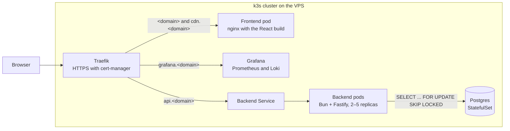
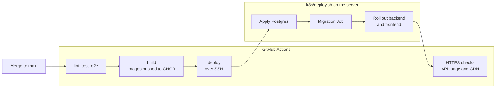

# ticket-booking-platform

A ticket booking system that sells 5,000 numbered tickets under heavy concurrent load without ever selling a ticket twice. Exam project for Chas Academy course 6 (Advanced fullstack, test & DevOps), built by Philip and Jennifer.

## Live system

| What | URL |
|---|---|
| Ticket page | <https://tickets.philipzachariasson.dev> |
| API | <https://api.tickets.philipzachariasson.dev> |
| CDN | <https://cdn.tickets.philipzachariasson.dev> |
| Grafana dashboard | <https://grafana.tickets.philipzachariasson.dev> |

- The API's endpoints are `GET /health`, `GET /tickets`, `GET /tickets/map`, `POST /reservations` and `POST /purchases`. Try <https://api.tickets.philipzachariasson.dev/health>.
- The CDN serves the page's hashed assets, so opening its root redirects to the ticket page ([ADR 0016](docs/adr/0016-page-on-domain-assets-on-cdn.md)).

## Architecture

Everything runs on a single-node k3s cluster on one VPS, with redundancy at the pod level ([ADR 0005](docs/adr/0005-single-node-no-node-level-ha.md)). For every part in detail, with its files and decisions, open the clickable [architecture map](docs/architecture/README.md).

### Request → database



- `<domain>` is `tickets.philipzachariasson.dev`.
- The HorizontalPodAutoscaler scales the backend between 2 and 5 pods at 50 % CPU.
- Each ticket is a row in `tickets`, and a reservation locks one row with `SKIP LOCKED`, so concurrent buyers never wait for each other or get the same ticket ([ADR 0002](docs/adr/0002-row-per-ticket-with-skip-locked.md)).

### Merge → deploy



- Pull requests run the same checks and build, but push and deploy nothing.
- Images are tagged with the commit SHA.
- A failed migration stops the deploy before the rollout ([ADR 0007](docs/adr/0007-migrations-with-dbmate-as-a-job.md)).
- A rollout starts a new pod before it removes an old one, so a deploy fails no requests ([ADR 0015](docs/adr/0015-zero-downtime-rollout.md)).

## Operations

- **Backups:** a CronJob uploads a `pg_dump` to Backblaze B2 every night at 03:00 ([ADR 0012](docs/adr/0012-daily-pg-dump-to-backblaze-b2.md), [restore runbook](docs/runbooks/restore-backup.md)).
- **Metrics and logs:** Prometheus, Loki and Grafana ([ADR 0013](docs/adr/0013-monitoring-stack.md), [monitoring runbook](docs/runbooks/monitoring.md)).
- **Server setup:** [server runbook](docs/runbooks/server-setup.md).
- **Decisions:** every decision with a real trade-off is an ADR in [docs/adr/](docs/adr/), and the grading criteria and order of work are in [docs/plan.md](docs/plan.md).

## Run the project locally

### Backend

You need Bun and Docker. From the repo root:

```
cd backend
bun install
cp .env.example .env
docker compose up -d --wait
bun run migrate
bun run import
bun run dev
```

- `docker compose up` starts Postgres 16 on `localhost:5433`.
- `bun run migrate` applies the SQL files in `backend/db/migrations/` with dbmate ([ADR 0007](docs/adr/0007-migrations-with-dbmate-as-a-job.md)).
- `bun run import` inserts the ticket numbers from `backend/db/data/biljettnummer_examination.csv`. It can be run again without changing anything.
- Check the result with `docker compose exec postgres psql -U postgres -d tickets -c "SELECT count(*) FROM tickets"`, which should say 5000.

### Frontend

With the backend running, from the repo root in a second terminal:

```
cd frontend
bun install
bun run dev
```

Open <http://localhost:5173>. The page calls the backend at `http://localhost:3000`, set in `frontend/.env.development`.

## Run the tests

From `backend/`:

```
bun run test
bun run test:integration
```

- `bun run test` runs the unit tests in `backend/test/unit/`. They need no database.
- `bun run test:integration` needs Docker running. It starts its own Postgres with Testcontainers, runs the migrations and tests the API against it, so it never touches the database from `docker compose up` ([ADR 0010](docs/adr/0010-integration-tests-with-testcontainers.md)).
- Run them through these scripts, not a bare `bun test`: the integration tests refuse to run without the preload that starts their database.

The e2e tests are Playwright tests in `frontend/e2e/`. From `frontend/`, with Docker running:

```
bunx playwright install chromium
bun run test:e2e
```

- `bun run test:e2e` starts and migrates its own Postgres with Testcontainers, like the integration tests, so it never touches the database from `docker compose up`. `playwright.config.ts` then starts the backend and builds and serves the frontend, so ports 3000 and 4173 have to be free.
- They need Bun 1.4 or later: `test:e2e` runs Playwright under Bun and `frontend/e2e/db.ts` uses Bun's SQL client. Run `bun upgrade` if `bun --version` says 1.3.

## Run a load test

k6 runs from Docker against the deployed system, and every run sells tickets in its database. How to run it, check the result and reset the tickets: [loadtests/README.md](loadtests/README.md).
